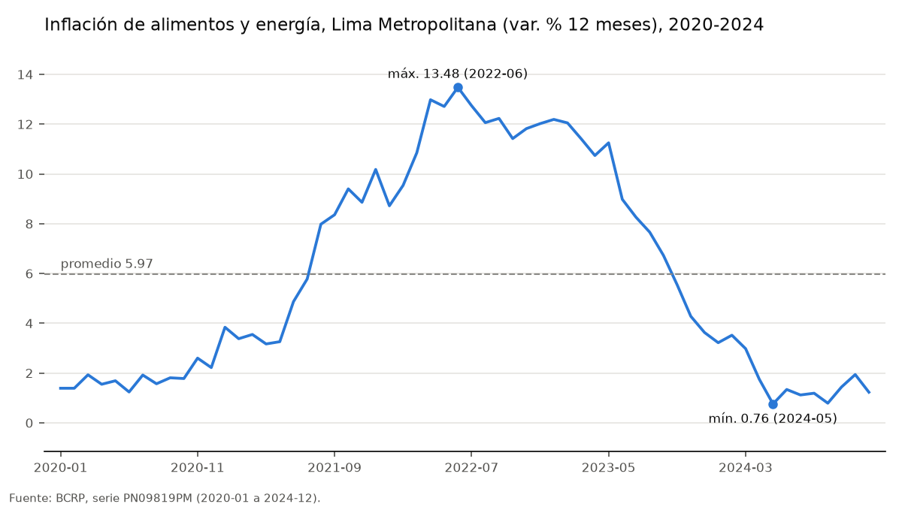
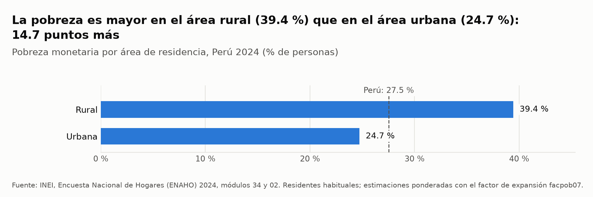
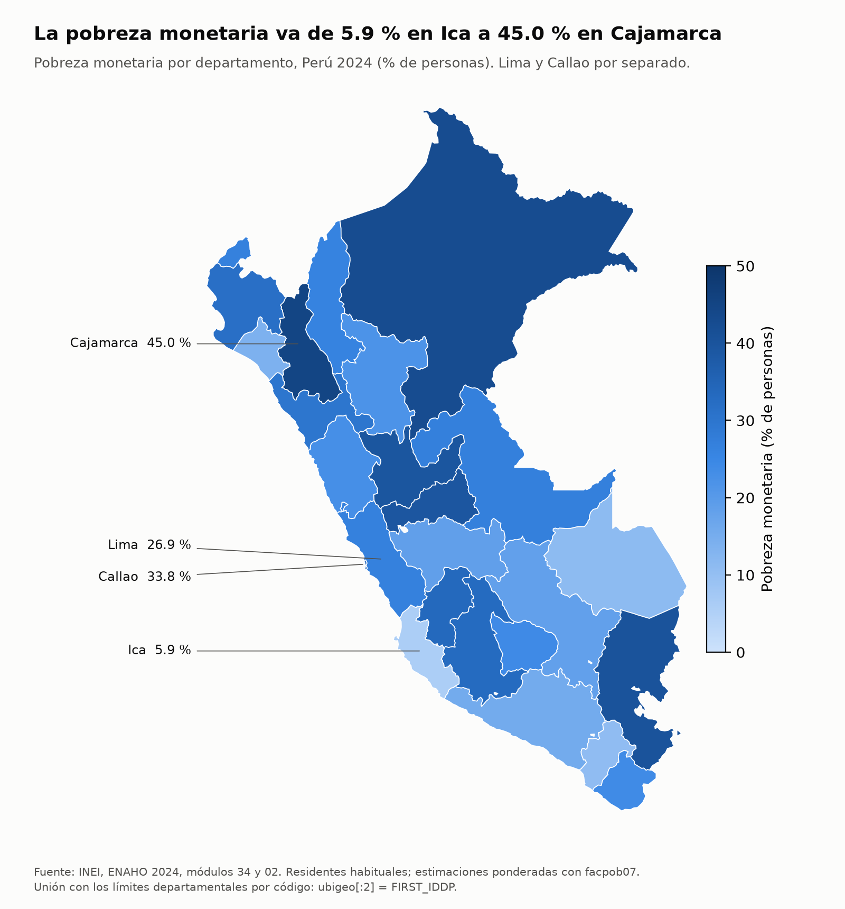

# Inflación 2020–2024 y pobreza monetaria en 2024: Perú

## 1. Pregunta de investigación

«¿Cómo evolucionó la inflación en el Perú entre 2020 y 2024, en especial la de alimentos y energía, y qué diferencias de pobreza monetaria presentaban las zonas urbanas y rurales y los departamentos al cierre de ese período?»

La pregunta tiene dos partes que se responden por separado:

- la evolución mensual de la inflación entre enero de 2020 y diciembre de 2024;
- la foto de la pobreza monetaria en 2024, el último año del período.

Las dos fuentes se describen lado a lado. El informe no busca ni afirma una relación causal entre la inflación y la pobreza.

## 2. Fuentes y metodología

### Inflación: Banco Central de Reserva del Perú (BCRP)

Las series se consultaron el 8 de noviembre de 2026 en la API del BCRP, a través del servidor MCP `bcrp` del proyecto (`mcp/server.py`). Según el catálogo, las tres se actualizaron el 2026-10-08.

| Código | Serie | Unidad |
|---|---|---|
| PN01273PM | Índice de precios Lima Metropolitana – IPC | var. % 12 meses |
| PN09819PM | Índice de precios Lima Metropolitana – IPC Alimentos y Energía | var. % 12 meses |
| PN01277PM | Índice de precios Lima Metropolitana – IPC Sin Alimentos y Energía | var. % 12 meses |

- **Período:** mensual, de 2020-01 a 2024-12 (60 datos por serie).
- **Búsqueda:** los códigos se buscaron con `buscar_series`. También se buscó inflación por departamento y para el área rural:
  - `"ipc departamento"`, `"ipc rural"` e `"inflación ciudades"` no devolvieron ninguna serie;
  - `"precios arequipa"` solo devolvió series históricas anuales de 1960 a 1980 (por ejemplo, CD11113DA), que no sirven para este período.
- **Alcance:** por eso, la inflación de este informe es la de **Lima Metropolitana**, que el BCRP usa como referencia de la inflación del país.
- **Cálculos:** los primeros y últimos valores, los promedios, los máximos y los mínimos salen de la herramienta `resumen`. Los valores de cada diciembre salen de `serie`. No se hicieron cuentas a mano.

### Pobreza: INEI, Encuesta Nacional de Hogares (ENAHO) 2024

- **Módulos:** 34 (sumaria) y 02 (miembros del hogar), unidos en una base de personas con la Skill `limpiando-enaho` (`salidas/personas_2024.parquet`).
- **Población:** 108,664 residentes habituales, que representan a 34,147,766 personas.
- **Indicador:** porcentaje de personas en pobreza monetaria (`pobreza` = 1 o 2), ponderado con el factor de expansión `facpob07`.
- **Validación:** la base pasó 13 de 13 verificaciones (`salidas/validacion.txt`). Entre ellas:
  - la pobreza nacional es 27.53 % (INEI: 27.6 %);
  - con el método oficial de la sumaria (`factor07 × mieperho`), urbana 24.81 % y rural 39.30 % (INEI: 24.8 % y 39.3 %).
- **Gráficos:** se hicieron con la Skill `graficando-enaho` (cortes `area` y `departamento`).
- **Mapa:** se hizo con la Skill `mapeando-enaho`, que une `ubigeo[:2]` con `FIRST_IDDP` y compara cada departamento con la referencia de la sesión 16.

## 3. Hallazgos

### Hallazgo 1. La inflación subió con fuerza de 2021 a 2022 y volvió en 2024 al nivel de 2020

| Diciembre de | 2020 | 2021 | 2022 | 2023 | 2024 |
|---|---|---|---|---|---|
| IPC total, var. % 12 meses | 1.97 | 6.43 | 8.46 | 3.24 | 1.97 |

*Fuente: BCRP, PN01273PM, 2020-01 a 2024-12 (herramienta `serie`).*

- **Pico:** el máximo del período fue **8.81 % en junio de 2022**.
- **Mínimo:** fue **1.60 % en junio de 2020**.
- **Promedio:** de los 60 meses, **4.47 %**.
- **Cierre:** la serie empezó en 1.89 % (enero de 2020) y terminó en **1.97 % (diciembre de 2024)**.
- **2024:** el promedio fue 2.36 % y el mínimo, 1.78 % en septiembre.

*Fuente: BCRP, PN01273PM, 2020-01 a 2024-12 y 2024-01 a 2024-12 (herramienta `resumen`).*

### Hallazgo 2. Los alimentos y la energía subieron más y antes que el resto de precios, y bajaron también más

| Serie (var. % 12 meses) | Máximo 2020–2024 | Promedio 2020–2024 | Dic. 2024 | Mínimo 2020–2024 |
|---|---|---|---|---|
| IPC Alimentos y Energía (PN09819PM) | **13.48** (2022-06) | 5.97 | **1.23** | 0.76 (2024-05) |
| IPC Sin Alimentos y Energía (PN01277PM) | 5.92 (2023-03) | 3.22 | 2.60 | 1.57 (2021-02) |
| IPC total (PN01273PM) | 8.81 (2022-06) | 4.47 | 1.97 | 1.60 (2020-06) |

*Fuente: BCRP, PN09819PM, PN01277PM y PN01273PM, 2020-01 a 2024-12 (herramienta `resumen`).*

- **El pico más alto:** la inflación de alimentos y energía llegó a **13.48 % en junio de 2022**, el mismo mes del pico del IPC total y por encima de él. En diciembre de 2021 ya estaba en 10.18 % y en diciembre de 2022, en 12.02 %. *(BCRP, PN09819PM, 2020-01 a 2024-12, herramienta `serie`.)*
- **El pico más tardío:** la inflación sin alimentos y energía, que refleja la tendencia de fondo, tuvo un máximo más bajo y más tardío: **5.92 % en marzo de 2023**.
- **En 2024 el orden se invirtió:** la inflación de alimentos y energía cerró en **1.23 %**, por debajo de la sin alimentos y energía (2.60 %). Su promedio de 2024 fue 1.77 %, y su mínimo del período, 0.76 % en mayo de 2024. *(BCRP, PN09819PM y PN01277PM, 2020-01 a 2024-12; PN09819PM, 2024-01 a 2024-12.)*

### Hallazgo 3. En 2024, la pobreza era mucho mayor en el área rural y variaba mucho entre departamentos

**Por área:**

| Área | Pobreza monetaria (% de personas) | Pobreza extrema (% de personas) |
|---|---|---|
| Rural | **39.4** | 15.6 |
| Urbana | **24.7** | 3.1 |
| Perú | 27.5 | 5.5 |

*Fuente: INEI, ENAHO 2024. Residentes habituales, ponderado con `facpob07`. Cálculo de las Skills `graficando-enaho` y `limpiando-enaho` (`salidas/indicadores.csv`).*

- **Brecha:** la pobreza rural supera a la urbana en **14.7 puntos** (cifra que imprime la Skill `graficando-enaho`). *(INEI, ENAHO 2024.)*
- **Método oficial:** con la sumaria, como publica el INEI, las cifras son urbana 24.8 % y rural 39.3 %. *(INEI, ENAHO 2024; `salidas/validacion.txt`.)*

**Por departamento (25 departamentos, Lima y Callao por separado):**

| Más pobreza | % | Menos pobreza | % |
|---|---|---|---|
| Cajamarca | **45.0** | Ica | **5.9** |
| Loreto | 42.6 | Moquegua | 10.9 |
| Puno | 40.4 | Madre de Dios | 11.1 |
| Huánuco | 39.5 | Lambayeque | 14.1 |
| Pasco | 39.3 | Arequipa | 15.8 |

*Fuente: INEI, ENAHO 2024. Residentes habituales, ponderado con `facpob07`. Skills `graficando-enaho` y `mapeando-enaho`.*

- **Lima y Callao:** Lima registra 26.9 % y Callao, 33.8 %. *(INEI, ENAHO 2024.)*
- **Comparación con la referencia:** frente a la referencia de la sesión 16:
  - 6 de los 25 departamentos coinciden al redondear a un decimal;
  - 24 de los 25 difieren en 0.5 puntos o menos;
  - la diferencia máxima es de +0.52 puntos, en Puno (40.4 frente a 39.9).
  - La referencia se calculó con la sumaria (`factor07 × mieperho`), y esta base, con los residentes habituales.

*(INEI, ENAHO 2024; `salidas/comparacion_referencia.csv`.)*

## 4. Visualizaciones

**Figura 1. Inflación de alimentos y energía, Lima Metropolitana, 2020–2024 (BCRP)**

*Fuente: BCRP, PN09819PM, 2020-01 a 2024-12. El gráfico marca el promedio (5.97), el máximo (13.48, 2022-06) y el mínimo (0.76, 2024-05), calculados por la herramienta `graficar_serie`.*

**Figura 2. Pobreza monetaria por área, 2024 (ENAHO)**

*Fuente: INEI, ENAHO 2024. % de personas, ponderado con `facpob07`. El gráfico complementario por departamento está en [`../figuras/enaho_pobreza_por_departamento_2024.png`](../figuras/enaho_pobreza_por_departamento_2024.png).*

**Figura 3. Mapa de la pobreza monetaria por departamento, 2024 (ENAHO)**

*Fuente: INEI, ENAHO 2024. % de personas, ponderado con `facpob07`. Límites departamentales unidos por código (`ubigeo[:2]` = `FIRST_IDDP`).*

## 5. Interpretación

**La inflación.**

- **2020 y 2024:** entre 2020 y 2024, la inflación de Lima Metropolitana hizo un ciclo completo. Empezó en 1.89 % (enero de 2020) y en diciembre de 2024 volvió a 1.97 % *(PN01273PM, 2020-01 a 2024-12)*.
- **El episodio de 2021–2023:** la subida la encabezaron los alimentos y la energía, que llegaron a 13.48 % en junio de 2022 *(PN09819PM)*. El resto de la canasta subió menos y más tarde: su pico fue de 5.92 % en marzo de 2023 *(PN01277PM)*. Este patrón es coherente con un choque de precios de alimentos y combustibles que luego se trasladó, con menos fuerza, al resto de bienes y servicios.
- **2024:** el orden se invirtió. Los alimentos y la energía ya subían menos que el resto (1.23 % frente a 2.60 % en diciembre de 2024).

**La pobreza.**

- **Área:** en 2024, más de un tercio de la población rural estaba en pobreza monetaria (39.4 %), frente a una cuarta parte de la urbana (24.7 %) *(INEI, ENAHO 2024)*. La pobreza extrema rural (15.6 %) multiplica varias veces a la urbana (3.1 %).
- **Territorio:** la pobreza más alta se concentra en departamentos de sierra y selva (Cajamarca, Loreto, Puno, Huánuco y Pasco, todos sobre 39 %). La más baja está en departamentos de la costa sur (Ica, Moquegua) y en Madre de Dios.

**Las dos fuentes juntas.**

- **Qué muestran:** el período de mayor inflación de alimentos y energía fue 2022, y en 2024 la pobreza seguía siendo alta en el área rural y en varios departamentos. Las dos cosas se presentan una al lado de la otra.
- **Qué no muestran:** con estas fuentes no puede afirmarse que la inflación haya causado la pobreza observada en 2024, ni medir cuánto pesó. Para eso harían falta, por ejemplo:
  - la inflación de cada departamento y del área rural;
  - una serie de pobreza de varios años con el mismo método;
  - un diseño que separe la inflación de otros factores, como el empleo, el crecimiento o los programas sociales.

## 6. Limitaciones

- **Sin inflación regional ni rural en el BCRP:** la búsqueda en el catálogo del servidor MCP no encontró IPC por departamento ni para el área rural en 2020–2024. Las búsquedas «ipc departamento», «ipc rural» e «inflación ciudades» devolvieron 0 series, y solo hay series históricas de ciudades de 1960 a 1980.
  - Por eso la inflación es solo la de **Lima Metropolitana**, y no puede compararse departamento por departamento con la pobreza.
  - El INEI calcula un IPC a nivel nacional y por ciudades, pero no está en este catálogo.
- **Escalas de tiempo distintas:** la inflación se mide mes a mes durante cinco años. La pobreza es un solo dato anual (2024), así que este informe no describe cómo cambió la pobreza entre 2020 y 2024.
- **Base de residentes frente a sumaria:** las cifras de pobreza usan a los residentes habituales (108,664 personas en la muestra). El INEI publica con la sumaria (`factor07 × mieperho`), que cuenta a 109,842 miembros del hogar. Por eso hay diferencias de algunas décimas:
  - urbana 24.7 frente a 24.8;
  - rural 39.4 frente a 39.3;
  - Puno 40.4 frente a 39.9.
  - No se forzó ninguna cifra para igualar la referencia (`salidas/validacion.txt`).
- **Error de muestreo:** la ENAHO es una encuesta por muestreo. Las cifras departamentales tienen más error que la nacional, y la muestra de algunos departamentos es más pequeña (por ejemplo, Madre de Dios, 2,045 personas). Este informe no calcula intervalos de confianza.
- **La pobreza ya usa precios:** la línea de pobreza del INEI se actualiza con los precios. Por eso la inflación ya está incorporada en la medición de la pobreza, y la comparación entre las dos fuentes no es independiente.
- **Datos que pueden cambiar:** las series del BCRP se consultaron el 2026-11-08 (actualizadas el 2026-10-08). Una revisión posterior del banco podría cambiar algún decimal.

## 7. Reproducibilidad

### Herramientas MCP (servidor `bcrp`, `mcp/server.py`, declarado en `.mcp.json` como `uv run mcp/server.py`)

| Herramienta | Argumentos usados | Para qué |
|---|---|---|
| `buscar_series` | `"ipc 12 meses"` (Mensual), `"alimentos y energía"` (Mensual), `"índice de precios"` (Mensual) | Encontrar PN01273PM, PN09819PM y PN01277PM |
| `buscar_series` | `"ipc departamento"`, `"ipc rural"`, `"inflación ciudades"`, `"precios arequipa"` | Revisar si había inflación por departamento o rural: 0 series vigentes |
| `resumen` | PN01273PM, PN09819PM y PN01277PM, `2020-01` a `2024-12` | Primero, último, promedio, máximo y mínimo del período |
| `resumen` | PN01273PM y PN09819PM, `2024-01` a `2024-12` | Promedio y mínimo de 2024 |
| `serie` | PN01273PM y PN09819PM, `2020-01` a `2024-12` | Valores de cada diciembre |
| `graficar_serie` | PN09819PM, `2020-01` a `2024-12` | Figura 1 (`figuras/bcrp_PN09819PM_2020-01_2024-12.png`) |

### Skills del proyecto (`.claude/skills/`)

| Skill | Comando (desde `tarea_4/`) | Salida |
|---|---|---|
| `graficando-enaho` | `uv run .claude/skills/graficando-enaho/scripts/graficar.py --por area` | `figuras/enaho_pobreza_por_area_2024.png` |
| `graficando-enaho` | `uv run .claude/skills/graficando-enaho/scripts/graficar.py --por departamento` | `figuras/enaho_pobreza_por_departamento_2024.png` |
| `mapeando-enaho` | `uv run .claude/skills/mapeando-enaho/scripts/mapear.py` | `mapas/pobreza_departamento_2024.png` y `salidas/comparacion_referencia.csv` |
| `limpiando-enaho` | `uv run .claude/skills/limpiando-enaho/scripts/limpiar.py` | `salidas/personas_2024.parquet`, `salidas/indicadores.csv` y `salidas/validacion.txt` |

- **Base existente:** en esta ejecución, `salidas/personas_2024.parquet` ya existía (generado el 2026-11-07 con 13 de 13 verificaciones aprobadas). Por eso las Skills de gráficos y mapa no necesitaron volver a correr `limpiando-enaho`.
- **Desde cero:** para reproducir todo, hay que poner los zip de la ENAHO (`966-Modulo34.zip` y `966-Modulo02.zip`) en `datos/` y correr primero `limpiar.py`.

### Verificación manual

El 8 de noviembre de 2026 se revisaron a mano cinco cifras del informe, de las dos fuentes. Las del BCRP se buscaron en la tabla de la web del banco, y las de la ENAHO, en los archivos de salida y en la referencia del curso. Las capturas están en `evidencias_ia/integracion/`.

| # | Afirmación del informe | Valor en el informe | Fuente consultada | Valor en la fuente | ¿Coincide? | Diferencia |
|---|---|---|---|---|---|---|
| 1 | Inflación total de Lima Metropolitana en diciembre de 2024 (var. % 12 meses) | 1.97 % | [BCRP, PN01273PM](https://estadisticas.bcrp.gob.pe/estadisticas/series/mensuales/resultados/PN01273PM/html/2020-1/2024-12/), fila Dic24 | 1.97 | Sí | 0.00 |
| 2 | Pico de la inflación total en junio de 2022 | 8.81 % | BCRP, PN01273PM, fila Jun22 | 8.81 | Sí | 0.00 |
| 3 | Pico de la inflación de alimentos y energía en junio de 2022 | 13.48 % | [BCRP, PN09819PM](https://estadisticas.bcrp.gob.pe/estadisticas/series/mensuales/resultados/PN09819PM/html/2020-1/2024-12/), fila Jun22 | 13.48 | Sí | 0.00 |
| 4 | Pobreza monetaria rural en 2024 | 39.4 % | Cifra oficial del INEI (README de la sesión 16 del curso y `salidas/validacion.txt`) | 39.3 | Sí, con una décima de diferencia | +0.1 |
| 5 | Pobreza monetaria de Cajamarca en 2024 | 45.0 % | `.claude/skills/mapeando-enaho/referencias/pobreza_departamento_2024.csv` (referencia de la sesión 16) | 45.0 | Sí | 0.0 (−0.01 con dos decimales) |

- **Cifras 1 a 3:** coinciden exactamente con la web del BCRP. El servidor MCP lee la misma serie de la API del banco.
- **Cifra 4:** la décima de diferencia no es un error. El informe usa a los residentes habituales (39.44 % en `salidas/indicadores.csv`); el INEI calcula con la sumaria, que cuenta a todos los miembros del hogar. Con el método del INEI, la base da exactamente 39.30 % (`salidas/validacion.txt`).
- **Cifra 5:** en `salidas/comparacion_referencia.csv`, Cajamarca tiene 44.99 % calculado frente a 45.0 % de referencia; al redondear a un decimal, coinciden.
